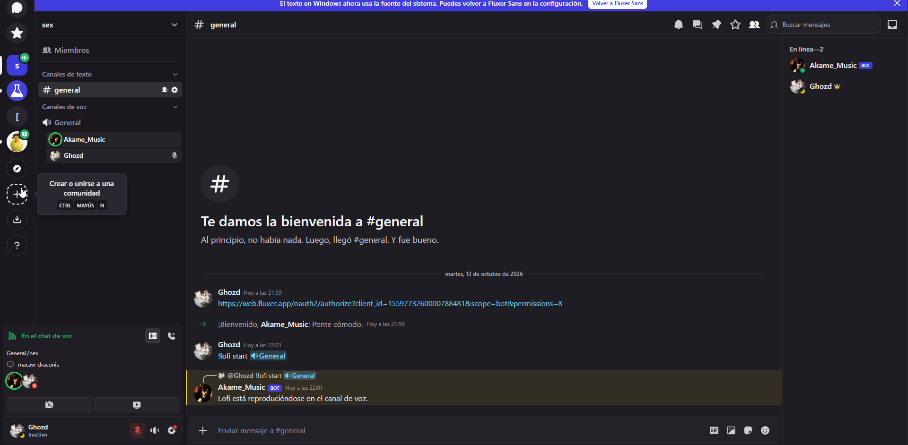

 

Bot de Fluxer para reproducir la radio Lofi 24/7 en un canal de voz.

> **Aviso:** la guía oficial de voz de Fluxer.js indica que esta API está siendo reescrita y recomienda no usarla en bots de producción. Este proyecto es una base funcional para pruebas, revisa la guía antes de desplegarlo.
---

## Requisitos

- Node.js 22.13 o superior
- FFmpeg instalado y disponible como `ffmpeg` en el `PATH`
- Un bot de Fluxer con acceso al servidor y permisos para ver canales, leer y responder mensajes, y conectarse/hablar en el canal de voz

En Ubuntu o Debian, instala FFmpeg con `sudo apt install ffmpeg`.

## Configuración

1. Instala dependencias con `npm install`.
2. Copia `.env.example` como `.env` y añade el token del bot en `FLUXER_BOT_TOKEN`.
3. Opcionalmente, establece `FFMPEG_PATH` si el ejecutable no se llama `ffmpeg`, o `LOFI_STREAM_URL` para cambiar la emisora.
4. Inicia el bot con `npm start`.

Este bot inicia sesión con el token del bot, como muestra la [guía oficial de Fluxer.js](https://fluxer.js.org/guides/basic-bot/).

## Comandos

- `!start <#canal>`: conecta el bot y empieza la radio en el canal indicado. También acepta un ID de canal.
- `!start` acepta únicamente menciones de canales o IDs de canal. Rechaza menciones de usuarios; el canal indicado debe ser de voz.
- `!pause`: pausa la fuente de audio.
- `!play` o `!resume`: reanuda la reproducción.
- `!stop`: detiene la radio y desconecta el bot.
- `!help`: muestra los comandos y sus alias.

Los comandos también aceptan alias en español y pueden invocarse mencionando al bot, por ejemplo `@bot start <id-del-canal>`. Se mantiene compatibilidad con el formato anterior `!lofi start`, `!lofi pause`, `!lofi play` y `!lofi stop`.

El canal de reproducción se guarda localmente en `data/lofi-sessions.json` y el bot intenta reconectarse allí al iniciar. Si `!start` apunta a otro canal, solo el propietario o un miembro con permiso de administrador puede cambiarlo, la radio se detiene y reinicia en el nuevo canal. El comando `!stop` borra el canal guardado para que no se vuelva a conectar automáticamente. Conserva la carpeta `data/` al actualizar o reiniciar el proceso, si se elimina, tendrás que ejecutar `!start` de nuevo.

La radio AAC se convierte a WebM/Opus con FFmpeg, formato que espera la implementación de voz actual. Los comandos deben enviarse en un canal de texto del mismo servidor.

Para mantener la radio 24/7, ejecuta el bot en un servidor que permanezca encendido y mantén `npm start` bajo un supervisor de procesos. FFmpeg intenta reconectarse si se corta la emisora, si el proceso del bot o el servidor se detienen, el audio también se interrumpe.
